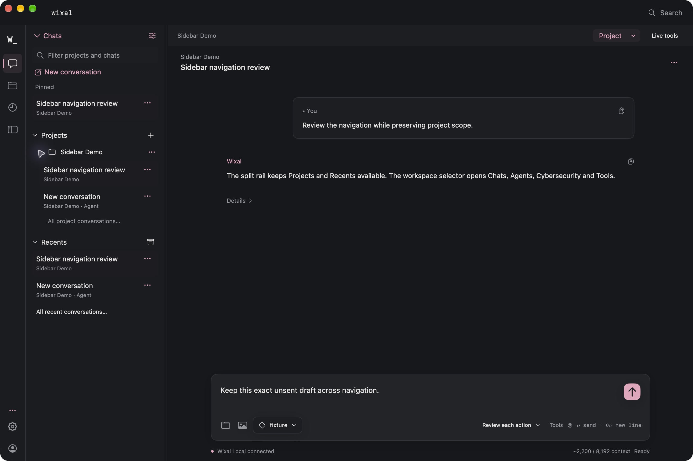
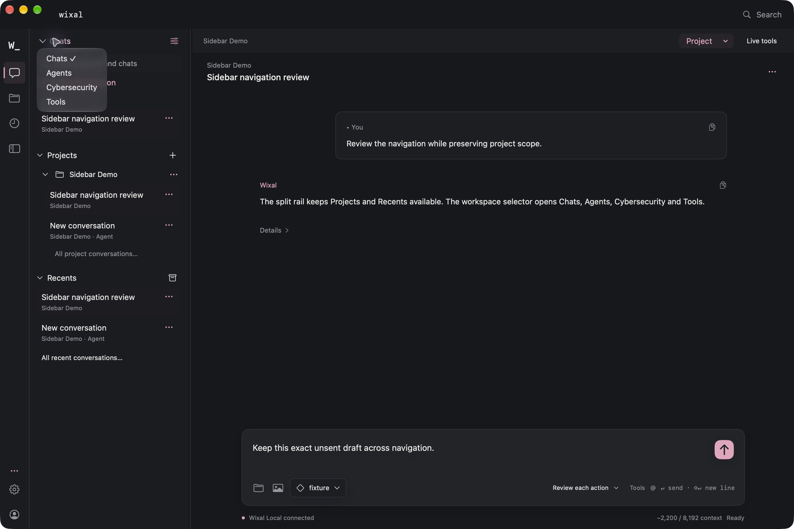
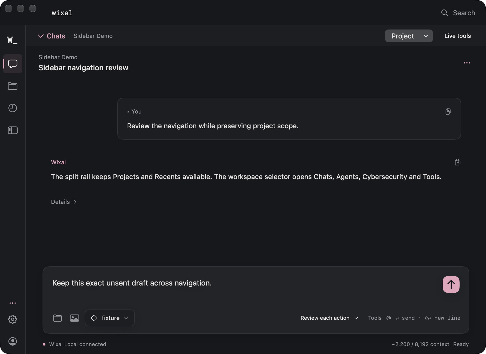

# Native split rail and workspace selector

Implements [issue #47](https://github.com/TheJhyeFactor/Wixal/issues/47). The existing native sidebar mixed specialist destinations with project history. The new narrow rail provides Chats, Projects and Recents, with Settings/account below; the wider sidebar has a Chats / Agents / Cybersecurity / Tools selector and shared project/conversation lists.

## Behavior

- The selector distinguishes presentation workspaces from the persisted chat/agent session mode. Opening Agents home, Cybersecurity or the Tools library does not create a conversation or change the active session. Returning to Chats resolves an existing chat or explicitly uses the existing conversation creation path, under busy guards.
- Project labels open the overview; their separate chevrons expand conversations. Project and session rows use stable IDs and expose accessible selection/state.
- Recents includes personal and project conversations. Bounded sidebar previews link to full project/history destinations. The full Recents destination is independent of a sidebar filter.
- Conversation menus retain rename, copy, archive and delete, and add local pin/unpin shortcuts. Pin IDs, workspace area, width and expanded project IDs persist in local preferences. Existing engine sidebar-collapse and section-expansion preferences remain compatible.
- The sidebar resizes from 216 to 320 points, with accessibility increment/decrement and width menu alternatives. Below 1100 points it starts compact; the rail toggle can reveal it without overwriting the saved wide-window preference. The selector remains in the content bar while compact.
- Settings no longer forces a collapse or navigates away when the sidebar expands. Existing Settings categories, sheets, approval flows, cybersecurity view identity, terminal and tool inspectors are retained.
- Search includes commands, projects and conversations, with project/type metadata. Original command aliases remain; Recents and Toggle sidebar (Command-B) are added.
- Cross-project conversation opening uses one validated `session-select` request with optional projectId. Invalid destinations leave project, session and mode unchanged; legacy callers still resolve within their active project.

## Verification

Environment: macOS 27.0.1, arm64, Swift 6.4, existing 0.7.10-alpha.6 version. No release version change or publication. Development packaging used a separate bundle identity, executable, disposable workspace and loopback model fixture. No real-model capability claim.

Passed:

- `PYTHONPATH=native/engine:native/tests native/.venv/bin/python -m unittest discover -s native/tests -v`: 514 tests.
- `swift build --package-path native --build-system native -c release --product WixalNative`.
- MarkdownAcceptance: 5 production-parser checks.
- ActivityAcceptance --self-test: 29 production-projection checks.
- InteractionAcceptance: 32 checks, including navigation preference corruption/clamping and stable pin identity round trips.
- Development package creation and `codesign --verify --deep --strict`.
- Packaged native UI: all four selector destinations, retained project/session and exact unsent draft, project expansion versus opening, cross-project Recents, pinning, search result activation, accessible width change from 248 to 264 points, and Settings retained through collapse and expansion.

- Native minimum window (920 × 640): automatic compaction, selector availability and temporary sidebar expansion.
- App relaunch: exact draft, pinned shortcut, expanded project and 264-point sidebar width retained.
- Live agent conversation entry points use engine session resolution rather than merely switching the composer presentation.

The engine regression adds failure-before-navigation, legacy same-project selection, cross-project selection and personal-workspace selection coverage. Draft text and session count remain unchanged during valid cross-project selection.

The canonical installed app and real workspace are not replaced. Temporary validation app/process cleanup is recorded after final verification. Screenshots contain a disposable fixture project. Broader VoiceOver, all-theme contrast, very large history performance and real-model qualification remain separate acceptance work.

