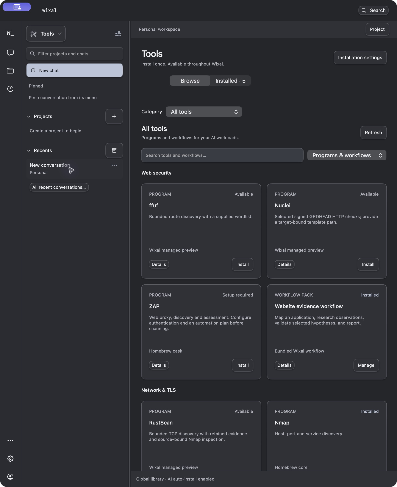
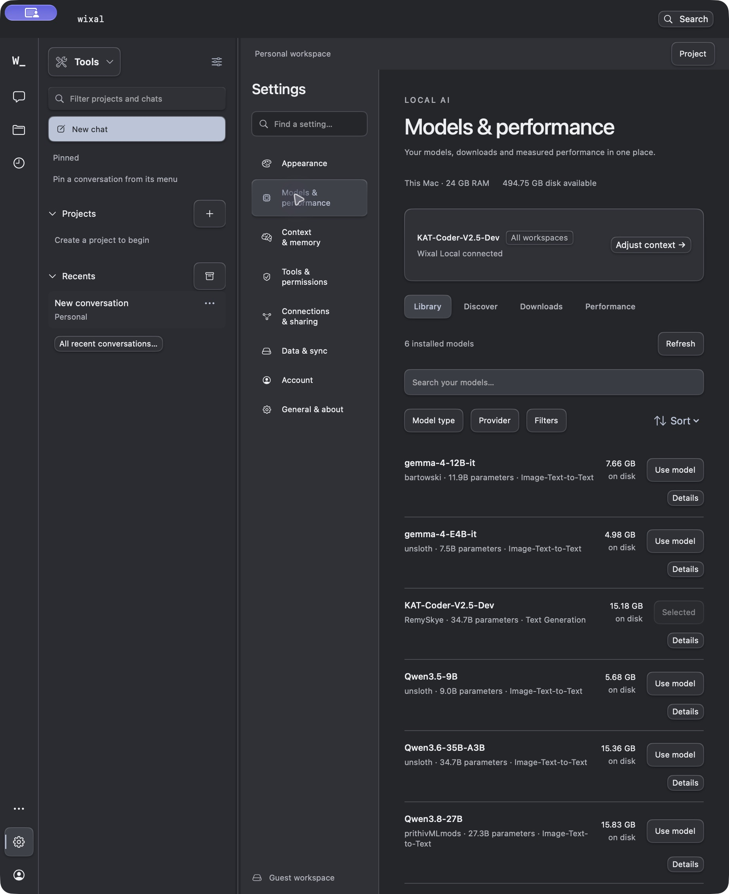
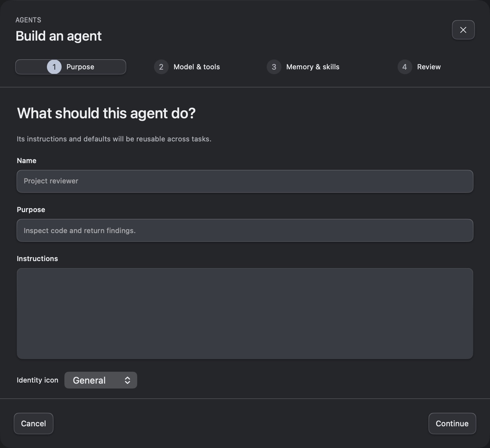
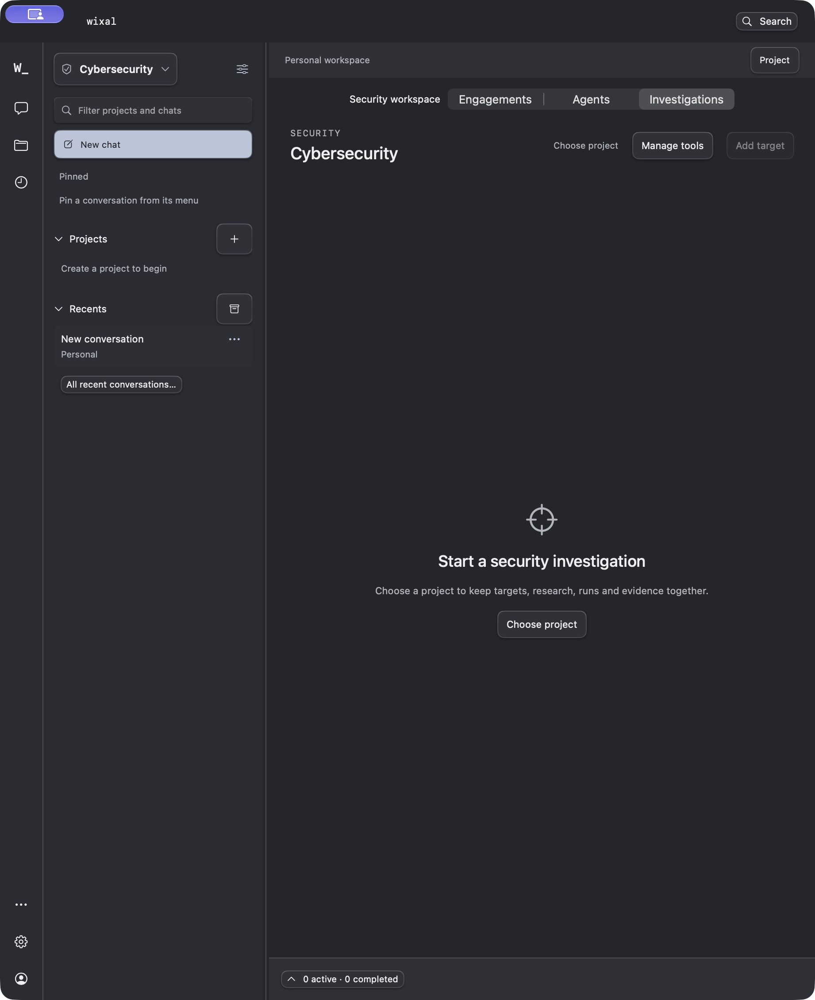
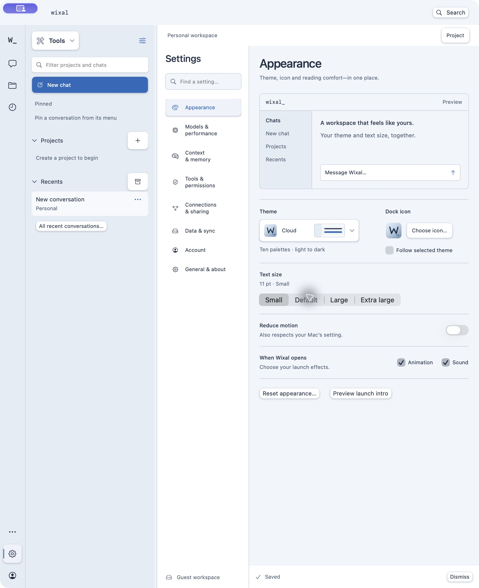
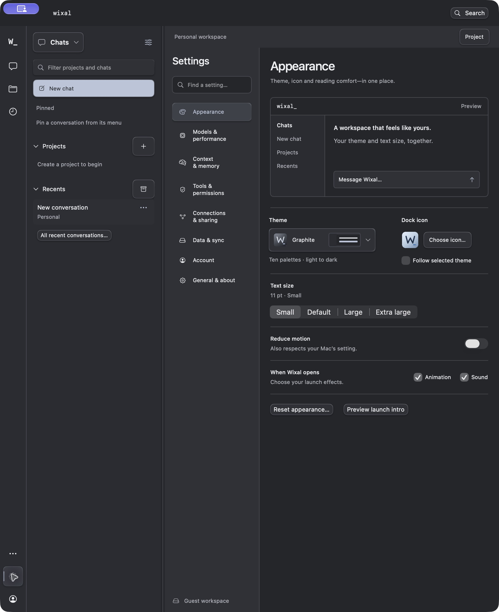

# App-wide Soft depth and duplicate build cleanup

Checked 14 October 2026 on Apple Silicon macOS 27.0.1, using the canonical installed 0.7.10-alpha.7 app. Follow-up to the [initial button treatment](../soft-depth/README.md). Feature: [#63](https://github.com/TheJhyeFactor/Wixal/issues/63).

## Resulting interface

Actions use the shared Soft depth style throughout the native workspace. The migration replaces 90 explicit plain-button overrides across Chat, Projects, Agents, Cybersecurity, Tools, Models, Settings, account/setup screens and drawers. The workspace supplies the shared default for actions without an explicit style. Navigation uses quieter selected/hover elevation while retaining its existing label geometry and accessibility selection traits. Destructive buttons retain destructive colouring, and disabled controls retain their original conditions.

Common cards and fields, plus custom editor, evidence, engagement and report surfaces, share fine edge highlights and contact/ambient shadows. There are 38 surface call sites, including the common card/field helpers. Compositing keeps labels crisp. Button movement continues to respect the app and macOS reduced-motion preferences. Theme/icon controls keep their existing padding, and palette names keep their full intrinsic text width.

No engine, execution, scope, approval or model-selection logic is changed. Native OS menus, pickers and switches retain their platform semantics.

## Verification

| Check | Result |
| --- | --- |
| Existing engine regression suite | 562 passed |
| New cleanup regressions | 7 passed |
| Release Swift/package build | Passed |
| Markdown / activity / interaction acceptance | 5 / 29 / 32 passed |
| Static style audit | No plain/native bordered button overrides remain in app-owned Swift sources |
| Signature/source verification | Strict signature; arm64; all 162 source entries match |
| Installed/package identity | Binary, engine helper, metadata and source manifest match |
| Workspace preservation | Recorded fields unchanged immediately after final replacement; conversation histories and draft contents retained during UI checks |
| Installed visual checks | Chat, Projects, agent builder, security workspace/forms, Tools, Models and Appearance; Graphite and Cloud |
| Installed interaction checks | Investigation navigation; agent wizard step navigation and cancel; tool Details/Done; theme picker save/restore; disabled Send and security-start controls |

The local engine run and the seven new cleanup cases are separate runs. CI runs the combined discovery suite. UI checks did not submit a message, create an agent/project/target, install a tool, or run an assessment. The selected KAT-Coder model and Graphite theme were retained after checks.

## Retired duplicates

The broader inventory found these obsolete Alpha 6 bundles outside the normal installation folders:

- `Wixal Cyber QA.app`
- `Wixal Cyber Final QA.app`
- `Wixal Cyber QA.app.previous`
- `Wixal.app.previous`

They were moved to Trash after checking the canonical app signature and confirming that none was running. Their workspace data, models, compressed archives and acceptance reports remain intact. Cybersecurity remains available inside the canonical Wixal application.

The cleanup command now supports `--include-build-copies` for repository release/artifact/output folders and Desktop/Downloads, plus repeatable `--search-root PATH` for another reviewed location. It recognises `.app.previous`, deduplicates overlapping roots and skips symlinks, Trash, local-runtime data, invalid metadata and unrelated identifiers. It refuses to retire running candidates. LaunchServices error `-10814` means a renamed bundle has no application registration; this is recorded without blocking retirement. Unexpected unregister errors still stop cleanup. The verified canonical app is then registered again so LaunchServices points to the retained installation. See [installation guidance](../../../native/README.md#installation-cleanup-required-after-every-release).

```sh
native/.venv/bin/python native/scripts/cleanup-installs.py --include-build-copies
native/.venv/bin/python native/scripts/cleanup-installs.py --include-build-copies --apply
```

Run retirement after package/archive creation and installed acceptance. ZIP rollback bundles are retained; Trash is not emptied.

## Installed screenshots

Captures use an empty personal workspace and unsaved editor. They contain no private project content.













## Evidence boundaries

The app remains an ad-hoc signed local Alpha 7 build. This change does not replace public GitHub release assets, change website downloads, or claim broader model/security/accessibility/notarisation qualification. Detailed local logs, preservation hashes and retirement reports are retained under `output/soft-depth-app-wide/`; private workspace details are excluded from this public record. Draft-save timestamps can change during navigation, so content/history checks are distinct from whole-database byte identity.
