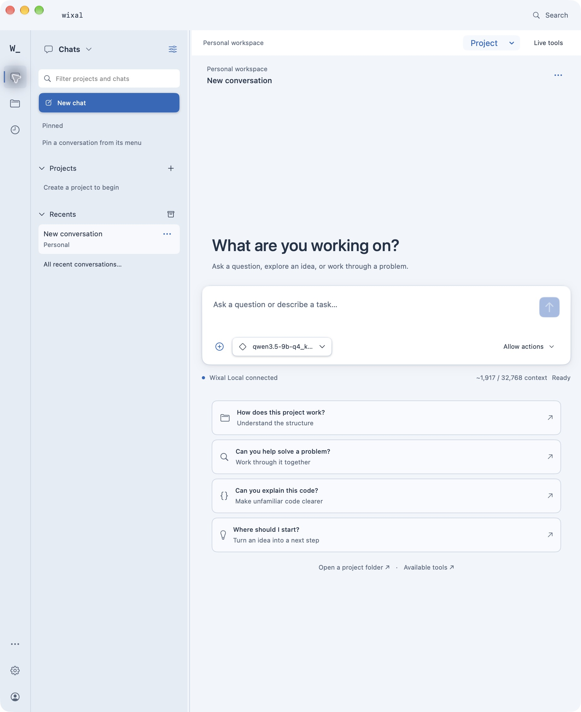
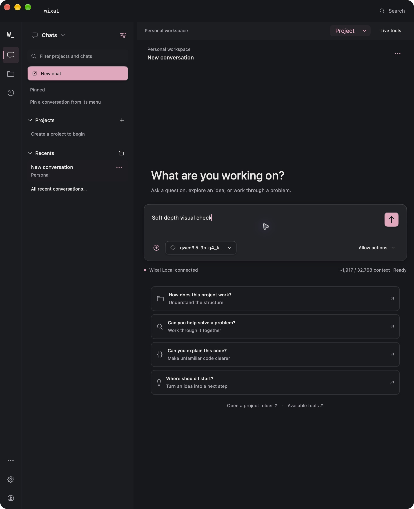

# Soft depth native UI acceptance

Checked 13–14 October 2026 on Apple Silicon macOS, using the installed 0.7.10-alpha.7 app. Feature: [#61](https://github.com/TheJhyeFactor/Wixal/issues/61). Implementation: [#62](https://github.com/TheJhyeFactor/Wixal/pull/62).

Outlined actions now use a fine upper-edge highlight and small contact/ambient shadows. New chat and Send/Stop share a primary style using the selected theme's accent and contrasting foreground. The composer uses a restrained edge highlight and shadow. Quiet navigation and existing action semantics, sizes, disabled conditions and keyboard shortcuts remain unchanged. Hover lifts enabled elevated controls by half a point; pressing lowers them and removes their outer shadow. Both the macOS and Wixal reduced-motion preferences suppress these offsets and transitions. Compositing keeps shadows behind the surface rather than behind individual glyphs.

## Local checks

| Check | Result |
| --- | --- |
| Engine regression suite | 562 passed |
| Release Swift build | Passed |
| Production Markdown acceptance | 5 passed |
| Production activity acceptance | 29 passed |
| Production interaction acceptance | 32 passed |
| Primary colour contrast | All ten palettes checked; minimum 5.47:1 |
| Packaged and installed signature | Strict verification passed |
| Packaged source provenance | 162 manifest entries; no drift |
| Installed/package parity | Binary, helper, metadata and manifest hashes match |
| Installed visual check | Cloud and Sakura, compact and wide composer layouts |
| Installed controls | Send disabled with empty draft and enabled with text; model button opens and closes its picker |
| Restart/preservation | Synthetic draft survived app replacement and relaunch; recorded workspace fields unchanged immediately after final install |
| Test cleanup | Synthetic draft cleared; seven session histories unchanged; original Cloud appearance and reduced-motion preference restored |
| Installation inventory | Exactly one canonical app in system/user application folders; no obsolete installed bundles found |

Commands used:

```sh
PYTHONPATH=native/engine:native/tests native/.venv/bin/python -m unittest discover -s native/tests -v
swift build --package-path native --build-system native -c release
swift run --package-path native --build-system native -c release MarkdownAcceptance
swift run --package-path native --build-system native -c release ActivityAcceptance --self-test
swift run --package-path native --build-system native -c release InteractionAcceptance
native/.venv/bin/python native/scripts/package.py --alpha
native/.venv/bin/python native/scripts/verify-release.py --installed /Applications/Wixal.app
native/.venv/bin/python native/scripts/cleanup-installs.py --apply
```

The isolated worktree reused the primary checkout's build Python and staged runtime. Logs, detailed hashes and the recoverable branch backup are retained locally under `output/soft-depth/`; workspace details are excluded from this public record. UI testing changes draft-save timestamps, so history/content checks are distinct from exact whole-database hashes.

Installed executable SHA-256: `f00b6bdbf7596830606c8004fa16e6e3d48e8b017daa6c5ece887041b358e5a3`.

Installed source manifest SHA-256: `d0c726c33a19e01023d451fbd8812581edef3742b3fc9c4e780791ec0d294f47`.

## Installed screenshots

These are actual native app captures with a synthetic draft or an empty conversation. They contain no personal project content. Cloud is the restored user theme; Sakura was used for dark-palette comparison.





## Evidence boundaries

This is a native styling update on the existing 0.7.10-alpha.7 version. It does not publish replacement GitHub release assets, change the website download, or establish additional real-model, full accessibility, security, signing or notarisation qualification. The app remains ad-hoc signed. Reduced-motion preference save/restore and source wiring were checked; system-wide accessibility qualification remains separate.
